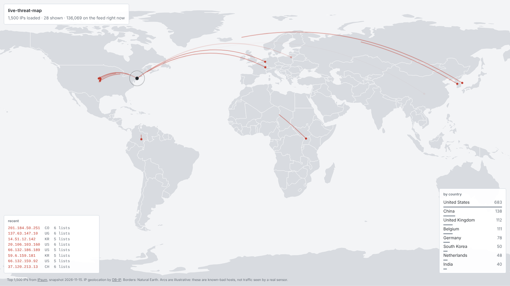

# live-threat-map

Animated world map of IPs that are currently on public malware and botnet blocklists.



The 1,500 most-listed IPs from [IPsum](https://github.com/stamparm/ipsum) are geolocated to
country level and replayed as connections to a single sensor. It's a static page with no build
step and no dependencies.

## Running

```
git clone https://github.com/appu-019/live-threat-map
cd live-threat-map
```

Then open `index.html` in a browser. It also works from `file://`, since the data is loaded with
script tags instead of `fetch()`.

Or serve it with GitHub Pages (Settings → Pages → deploy from `main`, root).

## Data

| what | source | notes |
|---|---|---|
| IPs | [stamparm/ipsum](https://github.com/stamparm/ipsum) | daily aggregate of ~30 blocklists; each IP comes with the number of lists it's on |
| geolocation | [DB-IP Lite](https://db-ip.com) via [sapics/ip-location-db](https://github.com/sapics/ip-location-db) | country level only |
| borders | [Natural Earth](https://www.naturalearthdata.com/) 1:110m | public domain |

`data/` holds a snapshot from 2026-11-15. To rebuild it from the current feeds:

```
python3 scripts/build_data.py
```

Python 3 with the standard library only. When you open the page online, the header also fetches
the live feed to show how many IPs are on it right now.

## Caveats

- Positions are country-level. Points are jittered around each country's label point so they
  don't stack exactly.
- The arcs are illustrative. These IPs weren't observed hitting this sensor. They're hosts that
  multiple blocklists agree are malicious.
- An IP's country is where it's registered or hosted, usually a VPS or cloud provider, not where
  whoever is operating it sits. That's a big part of why the US tops the list.

## License

Code is MIT (see `LICENSE`). The data keeps its upstream licenses. DB-IP Lite is CC BY 4.0,
which is why the page footer credits it.
